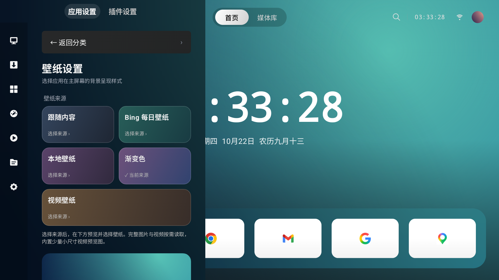
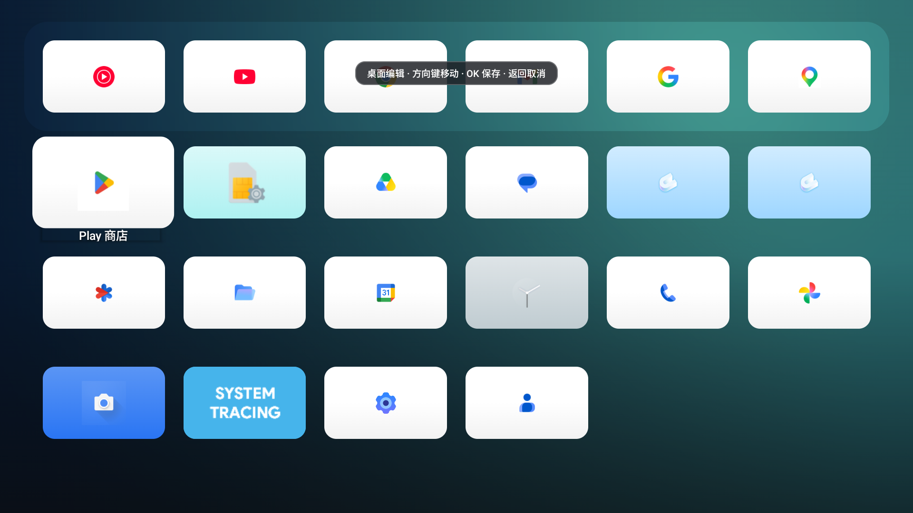
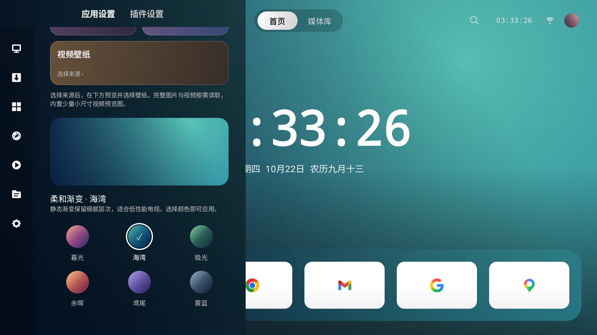
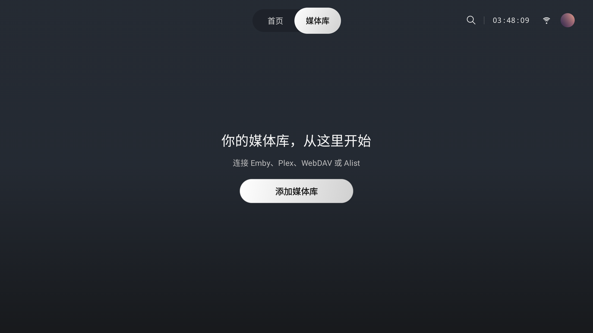

# ABU Launcher (阿布桌面)

[](https://kotlinlang.org)
[](https://developer.android.com/jetpack/compose)
[-blue.svg)](https://developer.android.com/about/versions/nougat)
[-orange.svg)](https://developer.android.com/about/versions/15)
[](https://qm.qq.com)
[](LICENSE)

**ABU Launcher（阿布桌面）** 是一款面向 Android 电视、机顶盒与掌机的原生桌面，围绕 **TV 模式、主机模式、掌机模式** 打造不同设备上的使用体验。

项目基于 **Kotlin + Jetpack Compose** 原生开发，注重遥控器、手柄与触控输入，以及媒体播放、插件扩展和流畅的焦点交互。

最新版本 **0.07**：[下载安装包](https://github.com/Mashiro000/ABU-launcher/releases/tag/v0.07) · [更新日志](CHANGELOG.md) · [版本说明](docs/RELEASE_NOTES_0_07.md)。

> **安装声明**：支持直接点击 APK 安装，安装后可从应用列表点击“阿布桌面”启动；ADB 与默认桌面设置均为可选。本版签名与旧 0.06 不同，覆盖安装可能失败，卸载会清除配置，请先记录或备份。详见[安装与恢复指南](docs/ADB_INSTALL.md)。

> 💬 **用户与开发者官方 QQ 交流群**：**`367281933`**（欢迎加群反馈体验、交流功能建议、获取最新内测包）

---
本次 0.07 实际界面（应用宝与 Android 模拟器截图）：








视频和预览画面来源见 [素材说明](docs/VIDEO_WALLPAPER_SOURCES.md)。

---

## ✨ 核心特性

- 📺 **TV 模式**：当前提供面向大屏的桌面、媒体库、遥控器焦点交互与播放器。
- 🎮 **主机模式**：以减少干扰、突出游戏内容为方向；控制中心已有入口，专属模式功能仍在开发。
- 🕹️ **掌机模式**：面向手持设备、手柄与触控场景；仍在开发，当前版本尚未提供完整模式。
- 🎨 **原生视觉与交互**：
  - G2 连续曲率超椭圆（Squircle）胶囊与卡片。
  - 高动态焦点悬浮光晕（Focus Glow & Sweep）与平滑缩放反馈。
  - 媒体卡片展开至电影/剧集详情页的弹性流体过渡（Spring 物理动画与共享时间轴入场动效）。
- 🎨 **原创渐变壁纸**：六组内置配色，圆形渐变色块选择，代码生成，基本不增加素材体积。
- 🎞️ **视频与每日壁纸**：内置在线航拍目录、真实画面预览、按需下载与本地视频；Bing 每日检查，支持锁定和历史选择。
- 📺 **Dock 内容预览（可关闭）**：读取支持应用的 Android TV 推荐频道与 Watch Next，展示内容与跳转按钮；没有公开数据时保留壁纸，默认关闭。
- 🌫️ **分代系毛玻璃与渐进模糊**：
  - **Android 12+ (API 31+)**：支持硬件加速实时背景模糊；Android 13+ 的设置背景支持渐进式模糊，导航条使用均匀模糊。
  - **Android 7.1 起**：提供后台降采样静态模糊，效果可按设备性能调整或关闭。
- 🎬 **本地与远程媒体库支持**：
  - 支持 WebDAV / Alist / Emby / Plex 多源接入与海报墙展示。
  - 主程序默认使用 Android Media3 与系统硬件解码；MPV 作为可按需安装的官方插件，不再增大主安装包。
- 🧩 **模块化插件平台**：
  - 内置官方插件仓库，可按当前设备 ABI 一键下载、验签、安装、启停和回滚插件。
  - 支持第三方 HTTPS 仓库、本地 `.abu-plugin` 导入、细粒度权限确认和风险提示。
  - 插件可声明设置页、首页、播放器悬浮层及完整页面，并通过受控能力桥访问宿主功能。
- 📺 **全输入形态交互适配**：
  - 完美适配电视遥控器方向键（D-Pad）、确认（Enter/DPad Center）及返回（Back）。
  - 兼容鼠标悬浮、滚轮操作与触控交互，支持标准 Android 手机、平板或车载屏幕。
- 🚀 **系统桌面与独立 TV 应用入口**：
  - 声明 `CATEGORY_HOME`、`CATEGORY_LAUNCHER` 与 `CATEGORY_LEANBACK_LAUNCHER`，既可直接设为系统默认桌面，也可作为普通应用运行。

---

## 💬 社区与交流

如果您在使用过程中遇到任何问题，或者有新功能想法与视觉建议，欢迎通过以下方式交流：

- **官方 QQ 交流群**：**`367281933`**
- **GitHub Issues**：欢迎直接提交 [Issue](https://github.com/Mashiro000/ABU-launcher/issues) 与 [Pull Request](https://github.com/Mashiro000/ABU-launcher/pulls)

---

## 🛠️ 技术栈与架构

- **应用名称**：ABU Launcher（阿布桌面）
- **包名 (Namespace)**：`com.limi.tvdesktop`
- **编程语言**：Kotlin 2.4.10
- **构建系统**：Gradle 9.5.0 / Android Gradle Plugin 9.3.2
- **Java 版本**：Java 17 (JavaVersion.VERSION_17)
- **UI 框架**：
  - Jetpack Compose Foundation & UI 1.10.4
  - Material 3 (1.4.0)
  - Activity Compose 1.12.2
- **毛玻璃效果**：Dev Chrisbanes Haze 1.7.2
- **视频引擎**：AndroidX Media3 ExoPlayer 1.4.1（默认）与可选 MPV 插件
- **插件脚本沙箱**：QuickJS；Ed25519 签名校验；独立 Android Service 隔离执行

插件开发者请从 [ABU Plugin SDK 开发指南](plugin-sdk/README.md) 开始；申请收录到应用内官方库请阅读 [官方插件库投稿指南](https://github.com/Mashiro000/ABU-plugins/blob/main/CONTRIBUTING.md)。

---

## 📂 项目结构

```text
├── Android/                    # Android Studio 工程根目录
│   ├── app/                    # 主应用模块 (com.limi.tvdesktop)
│   │   └── src/main/
│   │       ├── java/.../tvdesktop/  # Compose UI、转场、焦点管理、业务逻辑、播放器
│   │       └── res/                 # 矢量图标、壁纸与字体资源
│   ├── references/             # 设计规范、参考图与素材来源说明
│   ├── qa/                     # 验证文档与测试用例
│   ├── build.gradle.kts        # 工程级构建脚本
│   └── settings.gradle.kts     # 模块设置
├── plugin-sdk/                 # 第三方插件 TypeScript SDK、示例与打包工具
├── tools/                      # 官方 MPV 插件构建工具
├── docs/                       # 插件架构与开发文档
├── LICENSE                     # MIT 开源许可证
├── CHANGELOG.md                # 版本更新记录
└── README.md                   # 项目说明文档
```

---

## 🚀 编译与运行

### 运行环境要求
1. **JDK 21**（Gradle daemon 配置要求）
2. **Android SDK 36.1**（编译使用，最低运行版本为 Android 7.1 / API 25）
3. 最新版 **Android Studio** (推荐 Ladybug / Meerkat 或更高版本)

### 命令行编译

macOS / Linux：在 Android 目录运行 `./gradlew assembleRelease`。可通过 `ABU_SIGNING_STORE` 引用既有签名文件；密码与别名使用环境变量 `ABU_SIGNING_STORE_PASSWORD`、`ABU_SIGNING_ALIAS`、`ABU_SIGNING_KEY_PASSWORD`，不要把密钥或密码提交到仓库。未指定时沿用 Android debug 签名流程。


在 `Android` 目录下执行：

```powershell
# Windows 编译 Debug 版本
cd Android
./gradlew.bat assembleDebug

# Windows 编译 Release 版本
./gradlew.bat assembleRelease
```

编译成功后会同时生成 `arm64-v8a`、`armeabi-v7a`、`x86`、`x86_64` 与通用 APK，产物位于：
- **Debug 版**：`Android/app/build/outputs/apk/debug/app-<ABI>-debug.apk`
- **Release 版**：`Android/app/build/outputs/apk/release/`

### 安装到电视或模拟器

**直接安装：** 在 [0.07 发布页](https://github.com/Mashiro000/ABU-launcher/releases/tag/v0.07) 下载对应架构 APK 或 universal 通用包，用电视文件管理器点击安装。安装后可从“应用 / 全部应用”点击阿布图标打开；设置为默认桌面为可选操作。

**电脑辅助安装：** 安装 Android SDK Platform-Tools，在仓库根目录运行：

```bash
# 普通安装，自动识别 ABI 并校验官方下载
TV=192.168.1.20 bash tools/install.sh

# 用户选择默认桌面时再显式启用
TV=192.168.1.20 SET_HOME=1 bash tools/install.sh

# 恢复安装前记录的默认桌面，保留阿布和数据
TV=192.168.1.20 bash tools/restore.sh
```

**AI Agent 安装：** 将电视地址和仓库链接交给能执行电脑命令的 Agent，要求先阅读 [Agent 安装说明](docs/AGENT_INSTALL.md) 并按实际输出验收。

[详细安装与恢复教程](docs/ADB_INSTALL.md) 包含 Windows / macOS / Linux 命令、无线配对、架构选择、故障排查与校验方法。

> 0.07 使用维护者提供的阿布桌面密钥，与旧 0.06 的 debug 签名不同。旧版可能无法直接覆盖；先记录或备份配置，再决定是否卸载重装。脚本不会自动卸载或清数据。当前没有保持 ADB 常开或无障碍桌面守护功能，厂商 HOME 限制需实测。

### 参考与致谢

阿布桌面在开发过程中学习和参考了 [CleanYourTV](https://cleanyour.tv)、[Aerial](https://github.com/pengchujin/aerial-tv) 与 [Tigris](https://github.com/lesnolie/Tigris) 的安装引导、电视交互及性能优化思路。感谢作者与贡献者，他们的开源工作为本项目提供了灵感和参考。

阿布按自身设计风格和功能需求独立实现；如使用第三方代码、字体或素材，保留对应来源、版权与许可证声明。参考项目与本项目不存在背书关系。

---

## 📄 开源许可证

本项目基于 [MIT License](LICENSE) 开源。欢迎 Star、Issue 与 Pull Request！
