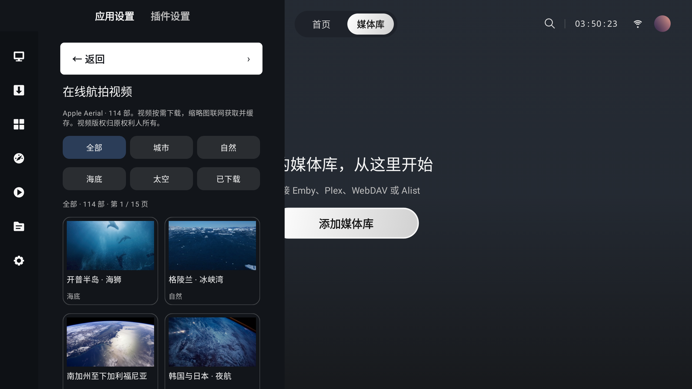
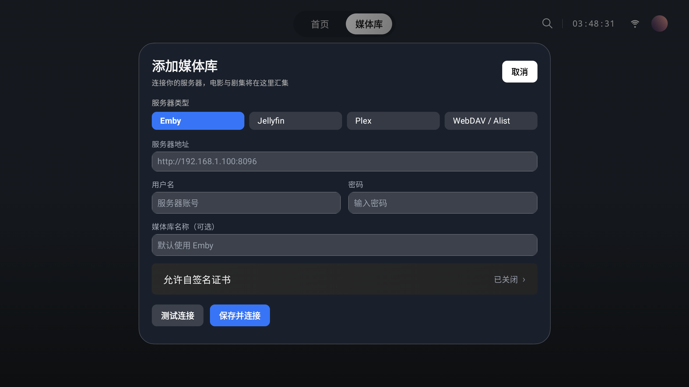
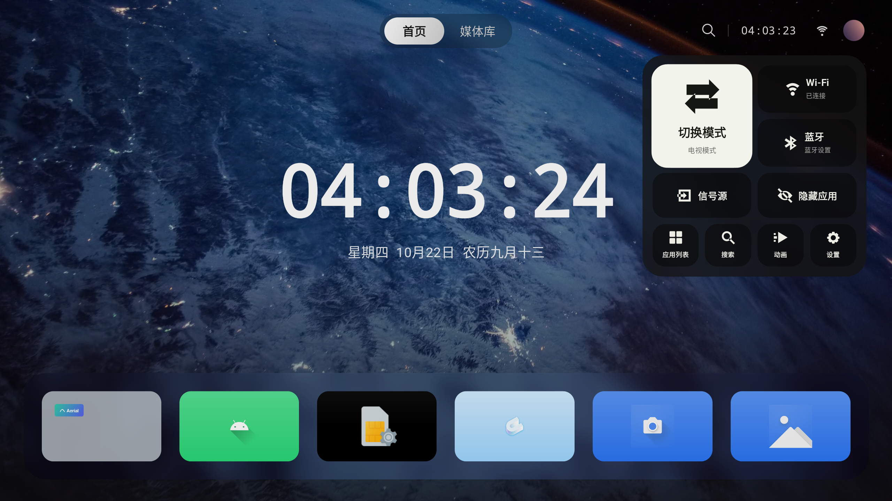
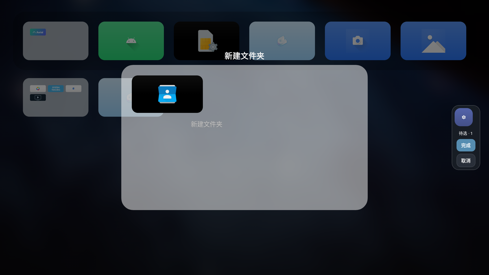

# ABU Launcher 0.07 · 桌面编辑、低性能优化与渐变壁纸

发布日期：2026-10-22。最低系统 Android 7.1（API 25）。提供 ARM64、ARM32、x86、x86_64 和 universal 五种安装包。

## 桌面与遥控器

- 修复文件夹新增时来源文件夹挡住待选栏的问题；右侧“完成”可点击并支持方向键进入，新增“取消”以恢复原配置；选择图标时增加约 300 ms 飞入待选区动画。

- 修复视频壁纸的实时模糊：改用嵌入式视频纹理参与背景采样；静态模糊模式下视频上的玻璃区域透明，不再重复绘制静态壁纸。打开桌面菜单不再暂停视频。

- 长按应用打开菜单，选择“移动”：只有当前图标抖动，方向键调整位置，其余图标顺序补位。
- Dock 与下方应用区分别移动，方向键不会意外跨区。确认保存，返回取消；顺序持久化。
- 修正编辑布局的全局/局部索引、位移宽度、行距与额外顶部间距，避免抖错图标、位置错乱和异常空行。
- 普通长按不再与拖拽抢同一个手势；明确进入移动后才接受拖拽。
- 菜单支持“添加到 Dock”；满额时选择要交换的 Dock 应用，确认交换或返回取消。
- 设置列表按一次方向键选择相邻选项，选中项尽量保持在视口中上位置，首尾遵循可滚动边界。
- 新增导航条设置：调整项目顺序、项目显隐和整条显隐。长按导航项目后左右移动，确认保存、返回取消。隐藏导航条后，右上角控制中心入口仍然保留。

## Dock 应用内容与访问锁

- 新增“Dock 内容预览”开关，默认关闭；关闭时始终保留用户壁纸。
- 开启并允许读取电视内容列表后，仅为 Dock 聚焦应用读取其公开的 Android TV 推荐频道和 Watch Next 内容。卡片、图片、标题和跳转入口来自应用，不限于继续观看。
- 内容区提供“打开内容”和“打开应用”按钮；可用方向键从 Dock 向上进入内容区，向下返回原 Dock 项。
- 只使用发布应用自己的内容 Intent，不允许跳转到其他包的指定组件或执行删除等非浏览操作。
- 需要 Android TV 8.0+ 的系统内容提供者和相应读取权限；应用未发布内容、厂商限制读取、无权限或设备不支持时回退壁纸。不能承诺所有应用都有内容。
- 不在下方应用网格显示此预览；进入移动模式或应用列表后清除预览。
- 方向密码弹窗与信号源共用居中玻璃面板；输入区改为一个统一底框，圆点数量表示已输入步数，不展示方向。
- 新建方向密码为 4–16 步；保留两次确认、错误重试、返回删除一步、清空和自动解锁流程，已有更长密码仍可验证。
- Android TV 接口参考：[推荐频道](https://developer.android.com/training/tv/discovery/recommendations-channel)、[PreviewPrograms 与内容入口](https://developer.android.com/reference/androidx/tvprovider/media/tv/TvContractCompat.PreviewPrograms)。

## 壁纸与视觉

- 修复 Apple 视频 CDN 在 Android 上缺少官方根证书导致的下载失败，仅对 sylvan.apple.com 配置 Apple 官方根证书，保留完整 HTTPS 校验。已在应用宝原站下载完整视频验证。

- 默认使用代码生成的渐变壁纸，彻底删除旧人物背景图片；已有用户主动选择的其他来源保留。
- 视频壁纸新增 114 条在线目录：城市 30、自然 41、海底 21、太空 22，支持分类、分页与已下载筛选。链接指向 Apple 公共 Aerial 视频 CDN，采用 H.264 SDR 版本，视频版权归原权利人；目录参考 aerial-tv 公共目录，完整视频不打包或重新分发。
- 目录采用真实视频画面预览卡片，缩略图全部通过网络按页加载并缓存，不内置在安装包。素材来源见 [来源说明](VIDEO_WALLPAPER_SOURCES.md)。
- 路径：设置 → 桌面外观 → 壁纸 → 视频壁纸 → 浏览并下载在线视频壁纸。选择条目后下载，完成后点击“设为视频壁纸”；支持进度、取消和删除，离开页面取消未完成下载。下载文件保存在应用私有目录，删除正在使用的视频时回到渐变背景。
- 下载检查 HTTP 状态、长度、磁盘空间和视频轨道，使用临时文件，失败/取消清理残留；单文件上限 1 GB。视频通常为数百 MB，下载源可用性取决于网络。
- 选择 Bing 后自动检查并下载图片，桌面运行期间每 30 分钟检查一次日期，跨日获取新图。程序关闭期间不进行后台定时唤醒，下次使用时补更新；断网稍后重试。
- 新增“锁定当前 Bing 壁纸”；手动选择历史图片自动锁定，关闭锁定恢复每日更新。锁定时手动下载今日图片保留当前背景。
- 修正二级设置共用行的固定宽度分配，短状态不再挤占大部分标题空间；增加焦点安全边距并统一背景。

- 新增“渐变色”壁纸来源，内置暮光、海湾、极光、余晖、鸢尾、雾蓝六组原创配色。
- 配色选项用圆形渐变色块表示，聚焦描边、选中标记与名称对应；选择后即时应用并保存。
- 渐变壁纸由代码按需生成，不打包大图或循环动画；保留低性能设备上的静态模糊视觉。
- 壁纸来源改为预览卡片，保留本地图片、Bing 与本地视频来源。缩略图在后台读取。
- 视频壁纸静音循环；打开控制中心、设置、应用列表及桌面弹窗保持播放，进入其他应用或屏保时暂停；读取/解码失败回退背景。
- 下载壁纸先校验图片再原子保存，保留最近十二张历史，避免失败下载成为损坏壁纸。

## 流畅度与包体

- 继续使用后台降采样静态模糊并限制缓存数量；动画模式与模糊策略分开，精简/无动画也能保留静态模糊。
- 页面与弹窗基础过渡 700ms → 600ms，焦点反馈 500ms → 400ms；其他显式过渡相应提速，短动画保留合理下限，不修改长按判定或网络超时。
- 文件夹创建改为 600ms 连续分段时间轴，保持源图标位置与目标预览格衔接。
- 保留列表按需组合、可见图标异步加载与有界图标缓存；正常浏览不运行编辑抖动。
- 删除演示媒体内容、假演职员图片与占位海报等 40 张无用图片，原资源文件合计约 6.5MB。真实媒体无封面时使用轻量占位绘制。
- 无媒体源时显示“添加媒体库”，支持遥控器向下聚焦并确认打开居中浮层，单层滚动、清晰分区与输入，认证失败不会直接保存；已配置但无数据时提供重试和管理入口。
- 应用内更新优先选择设备支持的 ABI 安装包，缺少对应包时才使用 universal。

### 安装包大小

以下比较本机保留的 0.06 Release 产物与本次 Release。它不是同一源码版本仅切换单一选项的受控实验；数据代表实际产物差异，不能将所有变化归因于某一项优化。

| 架构 | 0.06 | 0.07 | 缩小 |
| --- | ---: | ---: | ---: |
| arm64-v8a | 11.49 MB | 5.26 MB | 54.3% |
| armeabi-v7a | 10.77 MB | 4.53 MB | 57.9% |
| x86 | 11.40 MB | 5.17 MB | 54.7% |
| x86_64 | 11.54 MB | 5.30 MB | 54.1% |
| universal | 17.48 MB | 11.25 MB | 35.7% |

MB 按 1,000,000 字节计。此表为最终签名发布包，114 张预览图通过网络获取，不打包进 APK。

## 安装、签名与恢复

- 保留直接点击 APK 安装与安装后点击应用图标启动；设为默认桌面是可选操作。
- [详细安装指南](ADB_INSTALL.md) 包含架构选择、普通安装、Windows/macOS/Linux ADB、无线配对、SHA-256 校验、恢复和故障处理。
- [Agent 安装说明](AGENT_INSTALL.md) 提供可复制提示词、操作边界和验收要求。
- 安装脚本默认不改 HOME；显式 `SET_HOME=1` 才记录原桌面、设置并验收。签名冲突不会自动卸载或清数据。
- 本版采用维护者提供的阿布桌面密钥，证书 SHA-256 为 `e6eb923e3ca3026745099ecc91f7410ee32d6f0cc0c3b642bdd62929e7cfe954`。
- 旧版 0.06 的 debug 证书与本版不同，因此可能无法覆盖升级。请先记录或备份配置，再自行决定卸载重装；卸载会删除应用数据。后续发布需持续沿用本次密钥以保持签名兼容。
- 不提供保持 ADB 常开、无障碍桌面守护或通知监听复活组件，不宣称绕过厂商 HOME 限制。

## 验证与适用范围

实际构建、测试结果及待测范围见 [0.07 验证记录](../Android/qa/DESKTOP_0_07_VERIFICATION.md)。模拟器不能代表低性能电视的实际 GPU、解码器、遥控器、HOME 和待机行为；真机兼容与帧率需单独验证。

## 参考与致谢

阿布桌面在开发中学习和参考了 [CleanYourTV](https://cleanyour.tv)、[Aerial](https://github.com/pengchujin/aerial-tv)、[Tigris](https://github.com/lesnolie/Tigris) 的安装引导、应用编辑、电视交互和性能优化思路。感谢作者与贡献者提供的灵感和参考。

新增渐变壁纸借鉴电视界面中柔和色彩层次的表现方式，使用原创配色与代码绘制，未复制 Apple TV 壁纸素材。阿布继续沿用自身布局、圆角和玻璃视觉。第三方代码、字体、素材遵循各自许可证；致谢不代替版权声明。

## 本版实际截图

